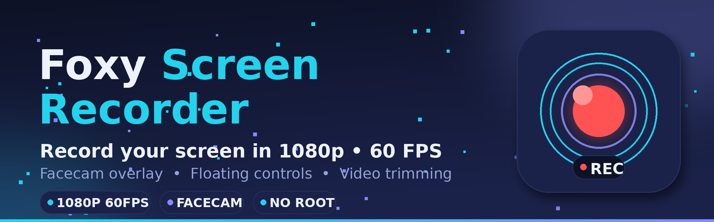

<p align="center">
  
</p>

<h1 align="center">🔴 Foxy Screen Recorder</h1>

<p align="center">
  <strong>A modern Android screen recorder — 1080p at 60 FPS, facecam overlay, floating controls and a built-in video trimmer.</strong>
</p>

<p align="center">
  <a href="https://github.com/foxylayzz777/Foxy-Screen-Recorder-/releases/latest">
    
  </a>
  
  
</p>

<p align="center">
  📺 <strong>YouTube:</strong> <a href="https://youtube.com/@foxyplayzz">@foxyplayzz</a> — gameplay, devlogs and updates
</p>

---

## ✨ Features

- 🎬 **1080p • 60 FPS recording** — crisp, smooth captures of gameplay, tutorials and anything on your screen.
- 🤳 **Facecam overlay** — record your front camera in a floating window right over the screen capture, perfect for reactions and commentary.
- 🎙️ **Customizable audio sources** — choose the audio you need: microphone, device audio, or both.
- 🎈 **Floating controls** — a movable overlay bubble lets you start, pause and stop without leaving your game or app.
- ✂️ **Built-in video trimmer** — cut the boring start and end off your recordings before you share them.
- 🔔 **Reliable background recording** — a foreground service keeps recording stable, with clear notification controls.
- 🚫 **No root required** — uses Android's official MediaProjection API, so it works on stock phones.

## 📲 Download & Install

1. Get the latest **APK** from the [Releases](https://github.com/foxylayzz777/Foxy-Screen-Recorder-/releases) page.
2. Install it (allow installs from your browser/files app if Android asks).
3. Open **Foxy Screen Recorder**, grant the permissions it asks for, and tap record.

## 🔐 Permissions — and why each one is needed

| Permission | Why |
|---|---|
| Screen capture (MediaProjection) | The core recording feature — Android asks you to approve it every time you start. |
| Microphone (`RECORD_AUDIO`) | Only if you choose mic or mixed audio. |
| Camera (`CAMERA`) | Only for the facecam overlay. |
| Display over other apps (`SYSTEM_ALERT_WINDOW`) | The floating control bubble and facecam window. |
| Notifications (`POST_NOTIFICATIONS`) | Recording controls and status in the notification shade. |
| Storage | Saving recordings and trimmed videos to your device. |

## 🛠️ Build from Source

Requirements: Android Studio (or the Gradle wrapper) and a JDK 17+ Android SDK setup.

```sh
git clone https://github.com/foxylayzz777/Foxy-Screen-Recorder-.git
cd Foxy-Screen-Recorder-
./gradlew assembleDebug
```

## 🧰 Tech Stack

- **Kotlin** — 100% native Android
- **MediaProjection + MediaRecorder** — official Android capture pipeline
- **Foreground services** — `ScreenRecordService` for capture, `FloatingOverlayService` for the floating controls and facecam

## 🙌 Credits

Made by **FoxyPlayzZ** — follow the journey on YouTube: [@foxyplayzz](https://youtube.com/@foxyplayzz)

---

<p align="center"><em>Record it. Trim it. Ship it. 🎬</em></p>
